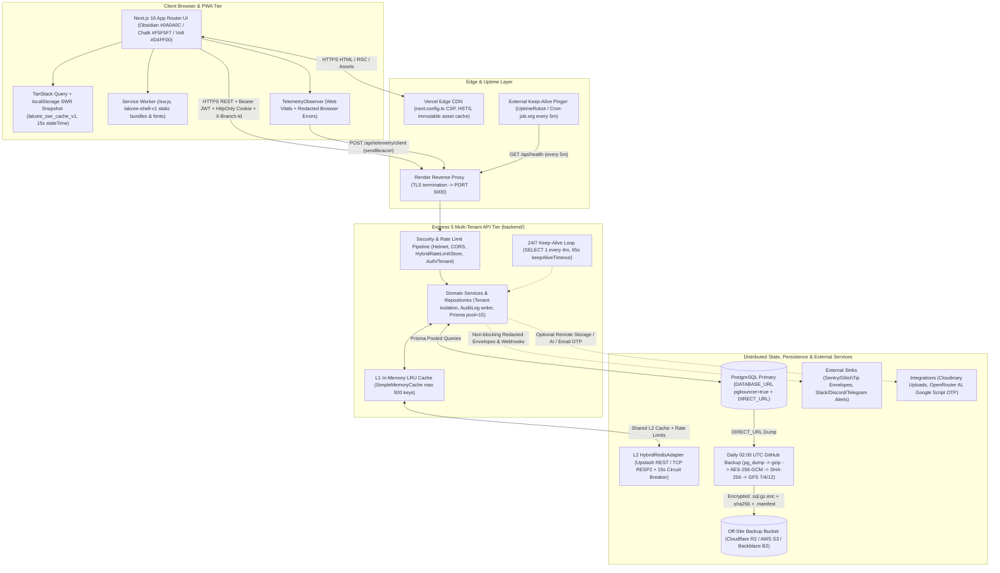
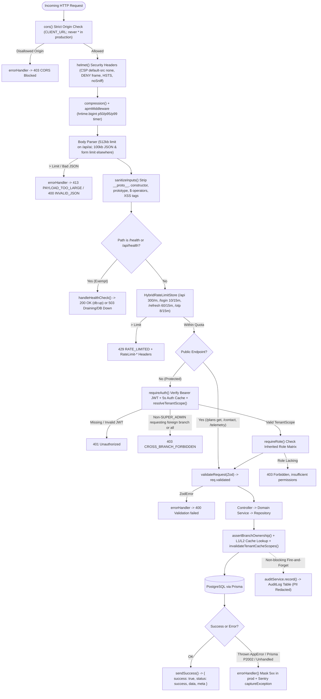
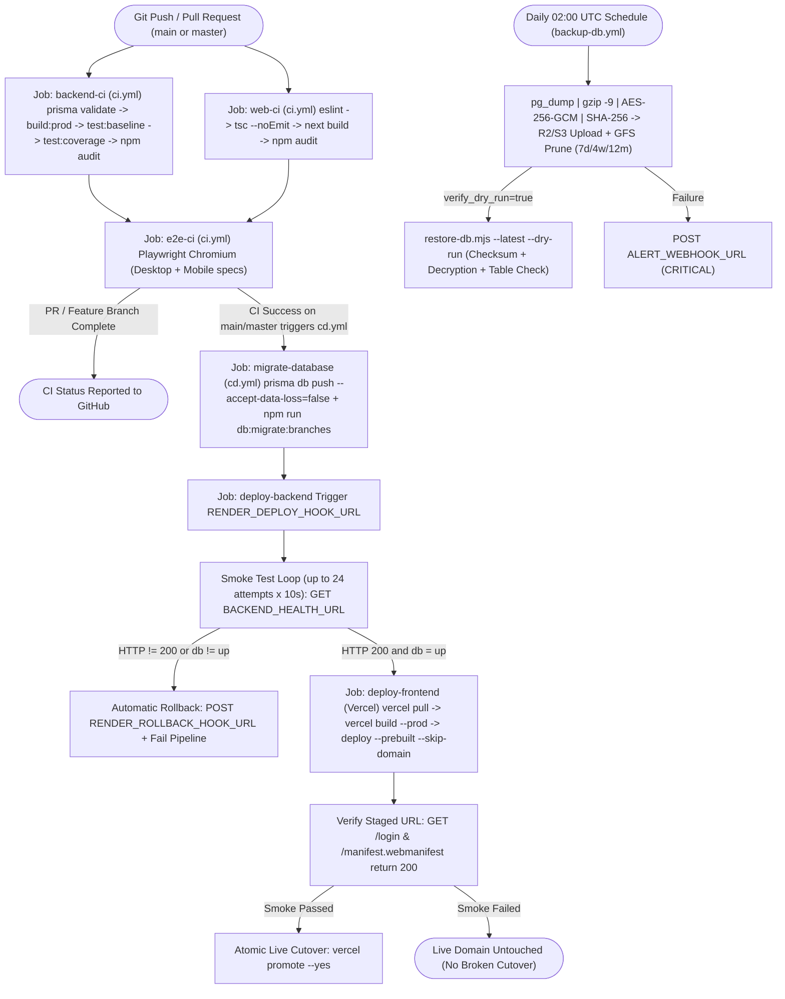

# System Architecture & Technical Design

Architectural blueprints derived directly from the **Lakzee Fitness Studio** codebase (`web/`, `backend/`, `backend/prisma/schema.prisma`, `scripts/`, and `.github/workflows/`).

Related documentation: [../README.md](../README.md) | [API.md](API.md) | [openapi.yaml](openapi.yaml) | [RUNBOOK.md](RUNBOOK.md)

---

## 1. High-Level Full-Stack & Scaling Architecture

---

## 2. Backend Request, Security & Tenant Isolation Pipeline

Every request flows strictly through the middleware chain mounted in `backend/src/app.ts` and route modules in `backend/src/routes/`.

---

## 3. Database Entity-Relationship Diagram (PostgreSQL / Prisma)

Modelled directly from `backend/prisma/schema.prisma`. All tenant tables carry nullable indexed `branchId` foreign keys backfilled idempotently to Primary Branch `BR-001` (`branch-primary-001`).

```mermaid
erDiagram
    BRANCH {
        string id PK "UUID or branch-primary-001"
        string name UK
        string code UK "e.g. BR-001"
        string location
        string status "ACTIVE | INACTIVE"
        datetime createdAt
        datetime updatedAt
    }

    USER {
        string id PK
        string email UK
        string password "bcrypt cost 12"
        string role "SUPER_ADMIN | BRANCH_ADMIN | ADMIN | RECEPTIONIST | TRAINER | STAFF | MEMBER"
        string branchId FK "Indexed (branchId, role, createdAt)"
        string firstName
        string lastName
        string phone
        datetime createdAt
    }

    REFRESH_SESSION {
        string id PK "JWT jti"
        string familyId "Rotation reuse family"
        string userId FK
        string tokenHash UK "SHA-256 hash"
        datetime expiresAt
        datetime revokedAt
        string replacedById
    }

    STAFF_PROFILE {
        string id PK
        string userId UK
        string designation
        string shiftStart
        string shiftEnd
        string specialization
    }

    MEMBER_PROFILE {
        string id PK
        string branchId FK "Unique per (branchId, memberId)"
        string memberId "Sequential per branch 001..N"
        string userId UK
        string qrCode UK "UUID scanned at reception"
        string trainerId FK "Assigned trainer User.id"
        datetime joiningDate
        datetime createdAt
    }

    MEMBERSHIP_PLAN {
        string id PK
        string branchId FK
        string name
        float price
        int durationDays
        float gstPercentage
        boolean isActive
    }

    SUBSCRIPTION {
        string id PK
        string branchId FK
        string memberId FK
        string planId FK
        datetime startDate
        datetime endDate
        string status "ACTIVE | EXPIRED | FROZEN | CANCELLED"
        string paymentStatus "PAID | PENDING"
        float balanceAmount
    }

    INVOICE {
        string id PK
        string branchId FK
        string invoiceNumber UK
        string memberId FK
        string subscriptionId UK
        float subtotal
        float gstAmount
        float totalAmount
        string status "PENDING | COMPLETED | FAILED | REFUNDED"
    }

    PAYMENT {
        string id PK
        string branchId FK
        string invoiceId FK
        float amount
        string method "CASH | UPI | CREDIT_CARD | DEBIT_CARD | BANK_TRANSFER | SPLIT"
        string status "COMPLETED | ..."
        datetime paymentDate
    }

    EXPENSE {
        string id PK
        string branchId FK
        string title
        string category
        float amount
        datetime date
    }

    ATTENDANCE {
        string id PK
        string branchId FK
        string memberId FK
        datetime checkIn
        datetime checkOut
        datetime date
    }

    DIET_PLAN {
        string id PK
        string memberId FK
        string title
        string mealsData
        boolean isActive
    }

    WORKOUT_ROUTINE {
        string id PK
        string memberId FK
        string title
        string exercisesData
        boolean isActive
    }

    AUDIT_LOG {
        string id PK
        string branchId FK
        string actorId
        string actorRole
        string action "ADMIN_LOGIN | MEMBER_CREATED | ROLE_CHANGED | BRANCH_CREATED..."
        string targetId
        string description
        datetime createdAt
    }

    SETTINGS {
        string id PK
        string branchId UK "One settings record per branch"
        string gymName
        string gstNumber
        string workingHours
    }

    ANNOUNCEMENT {
        string id PK
        string branchId FK
        string authorId FK
        string title
        string message
        datetime createdAt
    }

    CONSULTATION_INQUIRY {
        string id PK
        string branchId FK
        string name
        string phone
        string goal
        string status "NEW | CONTACTED | CONVERTED | CLOSED"
    }

    BRANCH ||--o{ USER : "scopes staff & members"
    BRANCH ||--o{ MEMBER_PROFILE : "isolates roster"
    BRANCH ||--o{ MEMBERSHIP_PLAN : "owns plans"
    BRANCH ||--o{ SUBSCRIPTION : "tracks subscriptions"
    BRANCH ||--o{ INVOICE : "tracks invoices"
    BRANCH ||--o{ PAYMENT : "tracks payments"
    BRANCH ||--o{ EXPENSE : "tracks expenses"
    BRANCH ||--o{ ATTENDANCE : "tracks visits"
    BRANCH ||--o{ AUDIT_LOG : "scopes audit trail"
    BRANCH ||--o| SETTINGS : "configures studio"
    BRANCH ||--o{ ANNOUNCEMENT : "publishes notices"
    BRANCH ||--o{ CONSULTATION_INQUIRY : "captures leads"

    USER ||--o| MEMBER_PROFILE : "has member profile"
    USER ||--o| STAFF_PROFILE : "has staff metadata"
    USER ||--o{ REFRESH_SESSION : "owns refresh tokens"
    USER ||--o{ ANNOUNCEMENT : "authors"
    USER ||--o{ MEMBER_PROFILE : "trains assignedMembers"

    MEMBER_PROFILE ||--o{ SUBSCRIPTION : "subscribes"
    MEMBERSHIP_PLAN ||--o{ SUBSCRIPTION : "defines terms"
    MEMBER_PROFILE ||--o{ INVOICE : "billed"
    SUBSCRIPTION ||--o| INVOICE : "generates"
    INVOICE ||--o{ PAYMENT : "settled by"
    MEMBER_PROFILE ||--o{ ATTENDANCE : "checks in"
    MEMBER_PROFILE ||--o{ DIET_PLAN : "receives"
    MEMBER_PROFILE ||--o{ WORKOUT_ROUTINE : "follows"
```

### Key Compound Indexes & Constraints (`backend/prisma/schema.prisma`)
- **`MemberProfile`:** `@@unique([branchId, memberId])`, `@@index([branchId, memberId])`, `@@index([branchId, createdAt])`, `@@index([branchId, joiningDate])`, `@@index([trainerId])`
- **`User`:** `@@index([branchId, role])`, `@@index([branchId, createdAt])`, `@@index([branchId, role, createdAt])`, `@@index([role, createdAt])`
- **`Subscription` & Ledger:** `Subscription` indexes `(branchId, status, endDate)`, `(branchId, createdAt)`, `(branchId, paymentStatus)`; `Invoice` indexes `(branchId, createdAt)`, `(branchId, status)`; `Payment` indexes `(branchId, paymentDate)`, `(branchId, status, paymentDate)`
- **`Attendance` & `AuditLog`:** `Attendance` `(branchId, date, checkIn(sort: Desc))`, `(memberId, checkOut)`; `AuditLog` `(branchId, createdAt)`, `(branchId, action, createdAt)`

---

## 4. CI/CD Quality Gates & Zero-Downtime Deployment Flow

Derived directly from `.github/workflows/ci.yml`, `.github/workflows/cd.yml`, and `.github/workflows/backup-db.yml`.

